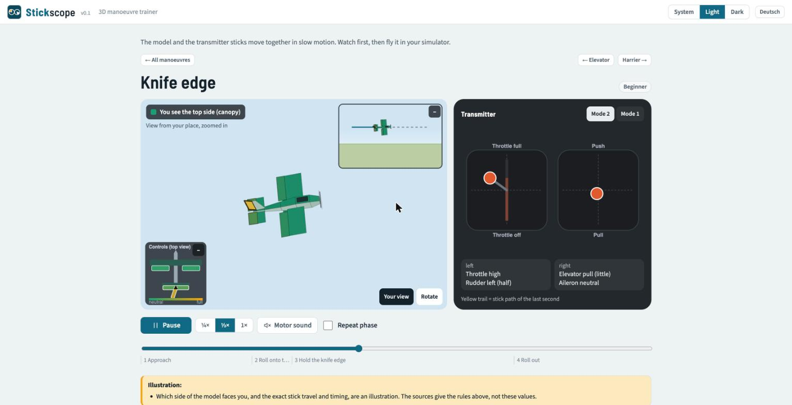

# StickScope



Live: https://stickscope.andreasknoor.com/

An animated 3D manoeuvre trainer for RC pilots. A 3D model and both transmitter sticks move together in slow motion, with an at-a-glance sketch, the flight path and step-by-step instructions, in English (default) and German. Figures are sorted into four categories (beginner, advanced, pro and motor glider) and chosen in a manoeuvre browser.

It is a static site: no backend, no accounts, no tracking, no external hosts.

## Accuracy rules

Correctness is the point of the app.

- Every instruction is confirmed by **at least two independent sources** (different authors, not copies of each other). Where sources disagree, the app says "Sources disagree". Where sources say nothing, or only one does, it says "No confirmed instruction". Nothing is filled in from general knowledge.
- The research behind each figure is in `docs/research/<figure>.md`; the sources are in `src/core/maneuvers/sources.ts`.
- Stick travel and timing in the animation are an **illustration** of the instructions, not measured values. Parts of the animation that the sources do not confirm (for example which side of the model faces the pilot) are marked as illustration on the page.
- `docs/verification/<figure>.md` has one checkbox line per phase for testing in a simulator.

## Commands

```
npm install
npm run dev          # http://localhost:3000
npm run lint
npm run typecheck
npm test             # vitest; npx vitest run path/to/file.test.ts -t "name" for one test
npm run build        # static export to out/
```

## How it is built

- `src/core/` is framework-free: figure data (`maneuvers/`), interpolation, the clock (`player.ts`), stick assignment for Mode 1 / Mode 2, control-surface highlighting. Imports use explicit `.ts` extensions.
- `src/render/` draws on canvas (model, sticks, control schematic, flight path, strip). The model and the sticks read the same clock, so they cannot drift apart.
- `src/ui/` is React: browser, trainer, instruction cards.
- `src/i18n/en.json` and `de.json` hold all user-facing text with identical keys. Tests enforce key, placeholder and markup parity and a complete text for every figure, phase, instruction and note.
- `src/theme/` is the look and feel copied from TLMscope (see `src/theme/README.md`).

## Adding a figure

1. Research it first: at least two independent sources per statement. Write `docs/research/<id>.md` (sources, statements with status, conflicts, open points).
2. Add the sources to `src/core/maneuvers/sources.ts` with an `independenceGroup` each.
3. Add `src/core/maneuvers/<id>.ts` (keyframes, phases, instructions with their sources, notes for disputed and missing parts) and register it in `src/core/maneuvers/index.ts` with its category.
4. Add the English and German texts under `figures.<id>` in `src/i18n/en.json` and `de.json` (names, idea, phase titles, instructions, notes, illustration notes).
5. Mark glossary terms in the new texts: wrap the first occurrence per phase in the tag of the term id, e.g. `<aileron>aileron</aileron>` (German: `<aileron>Querruder</aileron>`). Tapping such a word opens its explanation. Tags may sit inside `<b>`; a test checks that every tag is a known term.
6. Run `node scripts/make-verification.ts` to create `docs/verification/<id>.md`.
7. `npm test` checks the rest: phases cover the duration, sticks stay in range, every instruction has two independent sources, every text exists in both languages.

## Glossary

- Terms live in `src/core/glossary.ts` (id, group, related terms) and as `glossary.terms.<id>.name` / `.text` in `en.json` and `de.json`. The glossary has no source rule: the explanations describe what a word means and are not flying instructions.
- German names carry the English term in brackets (for example "Höhenruder (Elevator)"), so nobody has to switch languages to look a word up; a test checks this. English-only words that German pilots use as they are (Hover, Harrier) keep the English name.
- To add a term: add it to `GLOSSARY`, write name and text in both languages, and (optionally) add a pattern for it in the figure texts as above.

## Notes

- Which side of the model faces the pilot and the propeller direction depend on the model; the app does not claim one.
- Versioning: `major.minor` is shown in the page footer; see `CHANGELOG.md`.
